# Comparative Research Analysis: DCASS vs. State-of-the-Art Steganographic Methods

## 1. Executive Comparative Overview

Steganographic research over the past two decades has evolved across three major technological paradigms:
1. **Spatial & Frequency-Domain Modification Steganography** (e.g., LSB, J-UNIWARD, S-UNIWARD, WOW)
2. **Generative Neural Steganography** (e.g., GAN-based, VAE-based, Diffusion-based latent encoding)
3. **Zero-Modification Multi-Modal Semantic Steganography** (**DCASS - Our Method**)

The table below contrasts DCASS against state-of-the-art methodologies across core security and performance parameters:

| Parameter | Spatial Modification (LSB / J-UNIWARD) | Generative AI Steganography (GAN / Diffusion) | **DCASS (Our Framework)** |
| :--- | :--- | :--- | :--- |
| **Physical Signal Modification** | Alters raw pixel bits, DCT coefficients, or audio samples | Generates synthetic artificial media from latent vectors | **Zero Modification (0.0% byte/pixel alteration)** |
| **Steganalytic Security ($D_{KL}$)** | High residual noise ($D_{KL} > 0.5$). Detected by SRNet with >95% AUC | Leaves AI synthesis artifacts (frequency spikes, checkerboards) | **Information-Theoretic Security ($D_{KL} = 0.0$)** |
| **Payload Reconstruction Error** | Sensitive to lossy compression (JPEG, MP3) | High decoding error rate under latent noise (20–40% BER) | **0.0% clean-channel BER within the RS correction budget; dropout unrecoverable** |
| **Multi-Modal Support** | Single modality (Image-only or Audio-only) | Single modality (usually Text-to-Image only) | **Unified Multi-Modal Engine** (512d CLIP/CLAP space) |
| **Payload Capacity ($R_{eff}$)** | High theoretical bit capacity, but low security | Extremely low capacity (< 2 bits per generated image) | **High Capacity (12.3 - 14.3 bits / carrier item)** |

---

## 2. Technical Comparison: Why DCASS Outperforms Other Research Labs

```mermaid
flowchart TD
    subgraph Class1["1. Spatial Modification Labs (LSB, J-UNIWARD)"]
        A1["Cover Image"] --> B1["Modify Pixel LSBs / DCT"] --> C1["Altered Stego Image"]
        C1 --> D1["SRNet Steganalyst\n(DETECTED! >95% Accuracy)"]
    end

    subgraph Class2["2. Generative AI Labs (GAN, Diffusion Steg)"]
        A2["Secret Message"] --> B2["Latent Vector Injection"] --> C2["Synthetic AI Image"]
        C2 --> D2["Deepfake / Frequency Artifacts\n(SUSPICIOUS STREAM!)"]
    end

    subgraph Class3["3. DCASS Framework (Our Zero-Modification Method)"]
        A3["Secret Payload"] --> B3["RS-ECC GF(2^8) Code"] --> C3["FAISS 512d Hypersphere Lookup"]
        C3 --> D3["Untouched Public Media Sequence\n(carrier D_KL = 0.0 | no content residual)"]
    end
```

### 2.1 Removal of Content-Residual Signatures (Scoped)
- **Other Labs (Spatial & Frequency Modification)**: Laboratories relying on spatial adaptive steganography (e.g., HUGO, WOW, S-UNIWARD) embed secret bits into complex image textures. Deep convolutional steganalysts like **SRNet** and **Ye-Net** extract high-order spatial noise residuals and can detect many modified covers with high accuracy.
- **Generative AI Labs**: Labs utilizing GANs or Stable Diffusion to synthesize steganographic images can introduce latent distribution artifacts (e.g., spectral spikes, unnatural textures) that deepfake detectors may flag.
- **DCASS Solution**: DCASS transmits **unmodified public media items**. Conditional on the selected item, the transmitted bytes equal the cover bytes, so the **carrier-content** KL divergence is zero:

$$D_{KL}\big(P_{cover}(X \mid \text{selected}) \parallel P_{stego}(X \mid \text{selected})\big) = 0.0 \quad \text{bits}$$

This removes the content-residual signal. It does **not** guarantee perfect secrecy or immunity to all steganalysis: the selection sequence and timing remain separate surfaces. The recorded C2 result includes small image/text selection shifts, and the recorded C3 warden result is negative/limited.

---

### 2.2 Codec Recovery Within the Correction Budget
- **Other Labs (Nearest-Neighbor Retrieval Steganography)**: Early semantic steganography prototypes suffered from a **70%–85% decoding accuracy bottleneck** caused by continuous floating-point noise and vector quantization drift.
- **DCASS Solution**: We integrate Reed-Solomon Error Correcting Codes over $GF(2^8)$. With $R = 2t$ parity bytes, Berlekamp-Massey detects and corrects up to $t$ damaged bytes per block.
- **Result**: DCASS records **0% BER on clean channels and within the $t=4$ budget**. This is not unconditional: at 5% carrier substitution, exact recovery falls to 61.2–70%; carrier dropout is unrecoverable in the current wire format.

---

### 2.3 Unified 512-Dimensional Multi-Modal Architecture
- **Other Labs**: Steganography systems are historically siloed by modality (Image steganography, Text steganography, or Audio steganography).
- **DCASS Solution**: We establish a **unified 512-dimensional embedding space** ($\mathbb{S}^{511}$) across all three modalities:
  - **Images**: OpenAI CLIP `ViT-B/32` (512d)
  - **Text**: OpenAI CLIP Text Encoder `ViT-B/32` (512d)
  - **Audio**: LAION CLAP `clap-htsat-unfused` (512d)
- **Result**: Senders can dynamically switch or mix carrier modalities across a single transmission sequence (e.g., sending 2 images, 1 text passage, and 1 audio clip) to adapt to real-time network traffic context.
