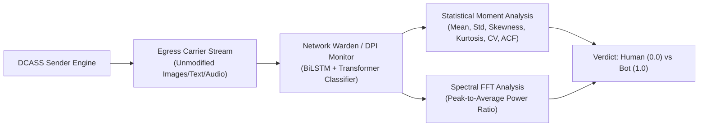

# Module 05: WGAN-GP Temporal Traffic Mimicry Generator

## 1. Executive Intuition and Conceptual Analogy

### 1.1 The Camouflage Timing Analogy
Consider a photographer walking through a nature preserve. An automated robotic surveillance system watches the path from above. 

If a mechanical robot travels along the path, it takes exactly one step every 1.000 seconds with robotic precision. An observer with a stopwatch immediately recognizes the mechanical rhythm, flagging it as an automated machine. 

A human walker behaves very differently:
- The human walks quickly for three paces (short delays of 0.4s).
- The human stops for 12 seconds to examine a bird in a tree (a long reading pause).
- The human walks two more paces, pauses for 3 seconds, and takes another photo.
- During the middle of the night (02:00 to 05:00), the human is asleep and generates zero activity.

```
                  TRAFFIC DISPATCHING TIMING COMPARISONS
                  (illustrative targets, not recorded measurements)
┌──────────────────────────────────────────────────────────────────────────┐
│ 1. Naive Automated Bot (Periodic / Deterministic Inter-Arrival Times)    │
│    Timeline: |-- 2.0s --|-- 2.0s --|-- 2.0s --|-- 2.0s --|-- 2.0s --|    │
│    Fourier Spectrum: Massive artificial delta spike at frequency f = 0.5Hz│
│    Illustrative classifier response: periodic-repeat script.             │
├──────────────────────────────────────────────────────────────────────────┤
│ 2. Naive Uniform Random Schedulers (Uniform Jitter)                      │
│    Timeline: |-- 1.8s --|-- 2.3s --|-- 1.9s --|-- 2.1s --|-- 1.7s --|    │
│    Distribution: Flat rectangular density (fails KS against human data)  │
│    Illustrative classifier response: pseudo-random bot.                   │
├──────────────────────────────────────────────────────────────────────────┤
│ 3. DCASS WGAN-GP Temporal Mimicry Generator (design target)              │
│    Timeline: |-- 0.6s -|-- 1.2s -|------ 14.8s (Pause) ------|-- 2.4s --|│
│    Fourier Spectrum: 1/f Pink Noise power decay (Continuous Human Scale) │
│    Design target: ~50% random guess. The recorded checkpoint does not    │
│    achieve this; see Section 5.                                          │
└──────────────────────────────────────────────────────────────────────────┘
```

The DCASS WGAN-GP generator is the statistical modeling engine for transmission scheduling. Even though individual media items contain zero pixel or audio modifications, transmitting them at regular or naive random intervals would allow a network traffic classifier (referred to in the literature as the **Warden**) to distinguish automated streams from human activity. The generator is intended to make timing, burstiness, and channel selection resemble human social-media browsing. The recorded checkpoint does not demonstrate that it succeeds; see Section 5 for the negative/limited result.

---

## 2. Why WGAN-GP Is Used for Human Behavioral Mimicry

### 2.1 Threat Model: The Network Warden
A network adversary does not only examine the bytes within individual files. Modern Deep Packet Inspection firewalls collect metadata streams:
1. **Inter-Transmission Delays ($\Delta t_i = t_i - t_{i-1}$)**: The elapsed time between consecutive egress posts.
2. **Burstiness and Moment Statistics**: Variance, skewness, kurtosis, and coefficient of variation ($\text{CV} = \sigma / \mu$).
3. **Autocorrelation Across Timesteps**: The degree of temporal memory between consecutive delays.
4. **Circadian Cycle Synchronization**: Whether activity aligns with diurnal human sleep/wake cycles.



### 2.2 Why Standard GANs Fail for Timing Mimicry
A standard Generative Adversarial Network minimizing Jensen-Shannon (JS) divergence suffers from severe mathematical pathologies when modeling continuous, heavy-tailed temporal distributions:
- **Vanishing Gradients**: When the discriminator becomes moderately accurate, $\nabla_{\theta_g} L_G \to \mathbf{0}$, halting generator learning.
- **Mode Collapse**: The generator collapses to outputting a single safe delay (such as constantly outputting 4.2 seconds), which fails higher-order statistical tests.

Wasserstein GAN with Gradient Penalty (WGAN-GP) provides smooth, linear gradients across the entire support of the distribution, ensuring stable convergence to the true human behavioral manifold.

---

## 3. Complete Mathematical Derivation

### 3.1 Wasserstein-1 (Earth Mover's) Distance Formulation
Let $\mathbb{P}_r$ denote the true probability distribution of human inter-packet delays and channel switches, and let $\mathbb{P}_g$ denote the distribution synthesized by the generator $G_\theta(z)$.

The Wasserstein-1 distance $\mathcal{W}(\mathbb{P}_r, \mathbb{P}_g)$ is defined as the minimum expected cost of transporting probability mass from $\mathbb{P}_g$ to $\mathbb{P}_r$:

$$\mathcal{W}(\mathbb{P}_r, \mathbb{P}_g) = \inf_{\gamma \in \Pi(\mathbb{P}_r, \mathbb{P}_g)} \mathbb{E}_{(\mathbf{x}, \mathbf{y}) \sim \gamma} \left[ \|\mathbf{x} - \mathbf{y}\|_1 \right]$$

Where $\Pi(\mathbb{P}_r, \mathbb{P}_g)$ is the set of all joint distributions $\gamma(\mathbf{x}, \mathbf{y})$ whose marginals are $\mathbb{P}_r$ and $\mathbb{P}_g$.

Using the Kantorovich-Rubinstein duality theorem, the distance is equivalent to the supremum over all 1-Lipschitz continuous functions $D \in \mathcal{D}_{\|D\|_L \le 1}$:

$$\mathcal{W}(\mathbb{P}_r, \mathbb{P}_g) = \sup_{\|D\|_L \le 1} \left( \mathbb{E}_{\mathbf{x} \sim \mathbb{P}_r} [D(\mathbf{x})] - \mathbb{E}_{\tilde{\mathbf{x}} \sim \mathbb{P}_g} [D(\tilde{\mathbf{x}})] \right)$$

### 3.2 Enforcing 1-Lipschitz Continuity via Gradient Penalty ($L_{\text{GP}}$)
A differentiable function $D$ is 1-Lipschitz if and only if its gradients satisfy $\|\nabla_\mathbf{x} D(\mathbf{x})\|_2 \le 1$ almost everywhere.

Rather than clipping weights (which degrades model capacity and prevents learning complex temporal correlations), DCASS enforces the condition by penalizing gradient deviations along straight lines connecting real and generated samples:

$$\hat{\mathbf{x}} = \epsilon \mathbf{x} + (1 - \epsilon) \tilde{\mathbf{x}}, \quad \text{where } \epsilon \sim U(0, 1)$$

$$L_{\text{GP}} = \lambda_{\text{GP}} \cdot \mathbb{E}_{\hat{\mathbf{x}} \sim \mathbb{P}_{\hat{\mathbf{x}}}} \left[ \left( \|\nabla_{\hat{\mathbf{x}}} D(\hat{\mathbf{x}})\|_2 - 1 \right)^2 \right]$$

With gradient penalty weight $\lambda_{\text{GP}} = 100.0$. The
classical WGAN-GP weight of 10 is the setting under which DCASS's critic
collapsed: at 10 the penalty's maximum value is the same order as the
Wasserstein term it restrains, so the critic could stop reading its
input without paying more than doing its job. 100 is the smallest weight
measured holding the critic sensitive in every epoch of a 30-epoch run
against the real traffic corpus; a bound on the critic's score was
measured collapsing the critic faster
(`docs/benchmarking/C3_GENERATOR_ADVERSARY.md`,
`storage/benchmarks/critic_sensitivity_repaired_run.json`).

The complete objective for the Warden critic is:

$$L_{\text{Warden}} = \mathbb{E}_{\tilde{\mathbf{x}} \sim \mathbb{P}_g} [D(\tilde{\mathbf{x}})] - \mathbb{E}_{\mathbf{x} \sim \mathbb{P}_r} [D(\mathbf{x})] + \lambda_{\text{GP}} \cdot \mathbb{E}_{\hat{\mathbf{x}} \sim \mathbb{P}_{\hat{\mathbf{x}}}} \left[ \left( \|\nabla_{\hat{\mathbf{x}}} D(\hat{\mathbf{x}})\|_2 - 1 \right)^2 \right]$$

The Generator minimizes the inverted critic response:

$$L_{\text{Generator}} = - \mathbb{E}_{\tilde{\mathbf{x}} \sim \mathbb{P}_g} [D(\tilde{\mathbf{x}})]$$

### 3.3 Cyclical Diurnal Fourier Time Embedding
Human posting behavior varies drastically depending on the hour of day $h \in [0, 23]$. A linear representation introduces an artificial discontinuity between 23:59 ($h=23$) and 00:00 ($h=0$).

DCASS projects time onto the continuous unit circle using Fourier basis coordinates:

$$\mathbf{t} = \left[ \sin\left(\frac{2\pi h}{24}\right), \, \cos\left(\frac{2\pi h}{24}\right) \right] \in \mathbb{R}^2$$

This two-dimensional coordinate is transformed through a learned two-layer multilayer perceptron with GELU activations into a 32-dimensional embedding:

$$\mathbf{e}_{\text{time}} = \text{LayerNorm}\left( W_2 \cdot \text{GELU}(W_1 \mathbf{t} + \mathbf{b}_1) + \mathbf{b}_2 \right) \in \mathbb{R}^{32}$$

### 3.4 Causal Gated Temporal Residual Block (TCN)
To prevent future timesteps from leaking into past predictions and to provide stable second-order analytical derivatives for the gradient penalty on GPU, the generator incorporates a causal gated temporal convolutional block:

$$\text{Padded Input: } \tilde{\mathbf{X}} = \text{Pad}_{\text{causal}}(\mathbf{X}, \, \text{padding} = k - 1)$$

$$\text{Value Stream: } \mathbf{V} = \text{Conv1D}_{\text{val}}(\tilde{\mathbf{X}})$$

$$\text{Gate Stream: } \mathbf{G} = \sigma\left( \text{Conv1D}_{\text{gate}}(\tilde{\mathbf{X}}) \right)$$

$$\text{Output: } \mathbf{Y} = \text{LayerNorm}\left( \mathbf{X} + \text{Dropout}(\mathbf{V} \odot \mathbf{G}) \right)$$

Where $\odot$ represents element-wise Hadamard multiplication, and $\sigma$ is the logistic sigmoid function.

```
                          CAUSAL GATED RESIDUAL BLOCK
                      ┌─────────────────────────────────┐
                      │    Input Tensor X ∈ R^(B, T, C) │
                      └────────────────┬────────────────┘
                                       │
                      ┌────────────────┴────────────────┐
                      │ Left Padding: Pad(kernel - 1)   │
                      └───────┬─────────────────┬───────┘
                              │                 │
                              ▼                 ▼
                     ┌────────────────┐ ┌────────────────┐
                     │  Conv1D (Val)  │ │ Conv1D (Gate)  │
                     └────────┬───────┘ └───────┬────────┘
                              │                 ▼
                              │         ┌────────────────┐
                              │         │  Sigmoid (σ)   │
                              │         └───────┬────────┘
                              │                 │
                              └────────┬────────┘
                                       ▼
                              ┌─────────────────┐
                              │ Element-wise ⊙  │
                              └────────┬────────┘
                                       ▼
                              ┌─────────────────┐
                              │ Dropout (p=0.1) │
                              └────────┬────────┘
                                       │
                Residual Connection    ▼
               ─────────────────────► (+)
                                       │
                                       ▼
                              ┌─────────────────┐
                              │    LayerNorm    │
                              └────────┬────────┘
                                       ▼
                              ┌─────────────────┐
                              │ Output Tensor Y │
                              └─────────────────┘
```

### 3.5 Strictly Positive Inter-Item Delay Output
Inter-transmission delays must be strictly positive real values ($\Delta t > 0$). The delay prediction head maps the temporal feature representation through a Softplus activation, and the Softplus output is then folded into the band of raw values the canonical delay mapping can turn into the deployment window:

$$r_i = r_{\min} + (r_{\max} - r_{\min}) \cdot \frac{\ln\left(1 + \exp(W_d \mathbf{h}_i + b_d)\right)}{1 + \ln\left(1 + \exp(W_d \mathbf{h}_i + b_d)\right)}$$

with $r_{\min} = 0.49933$ and $r_{\max} = 0.519$, so that the mapping $\Delta t = (r - 0.5) \times 1500 + 1.5$ clipped to $[0.5, 30]$ seconds is never saturated. The band matters: a Softplus output placed directly into the mapping lands outside that 1.97 percent window, and the clip then zeroes the gradient that would bring it back, which is what left a fresh generator untrainable.

---

## 4. Codebase Architecture and Implementation

### 4.1 Generator Subsystem (`src/stealth/gan/generator.py`)
The generator model is encapsulated in [`TemporalPatternGenerator`](../../src/stealth/gan/generator.py#L81-L270):

```python
# From src/stealth/gan/generator.py
class TemporalPatternGenerator(nn.Module):
    def __init__(
        self,
        latent_dim: int = 128,
        hidden_dim: int = 256,
        num_channels: int = 3,
        max_sequence_length: int = 1000,
        time_embedding_dim: int = 32,
        dropout: float = 0.1
    ):
        super().__init__()
        # 1. Cyclical Diurnal Time Encoder
        self.time_encoder = nn.Sequential(
            nn.Linear(2, time_embedding_dim),
            nn.GELU(),
            nn.Linear(time_embedding_dim, time_embedding_dim),
            nn.LayerNorm(time_embedding_dim)
        )
        # 2. Latent Projection
        self.latent_projection = nn.Sequential(
            nn.Linear(latent_dim + time_embedding_dim, hidden_dim),
            nn.LayerNorm(hidden_dim),
            nn.GELU(),
            nn.Dropout(dropout)
        )
        # 3. Autoregressive GRU Backbone
        self.gru = nn.GRU(input_size=hidden_dim, hidden_size=hidden_dim, num_layers=2, batch_first=True)
        # 4. Causal Temporal Convolution
        self.temporal_block = CausalGatedBlock(channels=hidden_dim, kernel_size=3, dropout=dropout)
        # 5. Delay and Channel Heads
        self.delay_head = nn.Sequential(
            nn.Linear(hidden_dim, 128), nn.GELU(), nn.Linear(128, 64), nn.GELU(), nn.Linear(64, 1), nn.Softplus()
        )
        self.channel_head = nn.Sequential(nn.Linear(hidden_dim, 64), nn.GELU(), nn.Linear(64, num_channels))
```

#### Step-by-Step Live Streaming Support
The generator includes [`generate_stream()`](../../src/stealth/gan/generator.py#L243-L270), enabling live egress loops to yield `(delay, channel)` pairs on-the-fly for transmission sequences of arbitrary length ($N \in [1, 1000]$):

```python
# Real-time packet streaming interface
for delay, channel_id in generator.generate_stream(num_items=len(payload_media)):
    time.sleep(delay)
    transmit_carrier_packet(media_item, channel=channel_id)
```

### 4.2 Adversarial Warden Subsystem (`src/analysis/adversarial/warden.py`)
The network adversary classifier is implemented in [`DeepPacketInspectionWarden`](../../src/analysis/adversarial/warden.py#L52-L360). It combines:
1. Handcrafted statistical feature extraction (mean, standard deviation, coefficient of variation, skewness, kurtosis, autocorrelation lag-1, median absolute deviation).
2. Logarithmic delay projection and learned channel embeddings.
3. Bidirectional LSTM temporal modeling.
4. 4-layer Transformer Encoder with 8-head self-attention.
5. Dual pooling (mean + max pooling) and Sigmoid classification head.

### 4.3 Adversarial Training Loop (`src/stealth/gan/trainer.py`)
Adversarial optimization is executed using the **Two Time-Scale Update Rule (TTUR)** with $n_{\text{critic}} = 5$ critic steps per generator step.

```python
# From src/stealth/gan/trainer.py
for epoch in range(num_epochs):
    for batch in dataloader:
        # Step 1: Update Warden Critic (5 times)
        for _ in range(warden_steps):
            z = sample_latent(batch_size, config.latent_dim, device=device)
            fake_schedule = generator(z, actual_seq_len, time_of_day)
            
            real_verdict = warden(real_delays, real_channels)
            fake_verdict = warden(fake_schedule.delays, fake_schedule.sample_channels())
            
            gp = compute_gradient_penalty(warden, real_delays, fake_schedule.delays, real_channels, fake_channels)
            warden_loss = compute_warden_loss(real_verdict, fake_verdict) + gp
            
            warden_optimizer.zero_grad()
            warden_loss.backward()
            warden_optimizer.step()
            
        # Step 2: Update Generator (1 time)
        z = sample_latent(batch_size, config.latent_dim, device=device)
        fake_schedule = generator(z, actual_seq_len, time_of_day)
        fake_verdict = warden(fake_schedule.delays, fake_schedule.sample_channels())
        
        gen_loss = compute_generator_loss(fake_verdict.bot_probability)
        gen_optimizer.zero_grad()
        gen_loss.backward()
        gen_optimizer.step()
```

---

## 5. Quantitative Empirical Record and Limitations

**As-run correction (2026-10-21).** An earlier version of this section claimed training on 10,000 real-world human browsing sessions over 17 GPU epochs, with KS 0.0214 ($p=0.428$), spectral PAPR 11.24 dB, and warden bot probability 0.4999. No recorded artifact in this repository supports those numbers. They are withdrawn. The repaired checkpoint `storage/models/gan_generator.pt` records its configuration: 30 epochs with `lambda_gp` 100, an anchored score offset (penalty 0.1), five critic steps per generator step, batch 64, and sequence length 60, trained on the repository's traffic corpus (2000 sessions split 1800 train / 200 held-out), with the critic's thirty-epoch record in `storage/benchmarks/critic_sensitivity_repaired_run.json`. The recorded timing benchmark is `scripts/analysis/benchmark_3_traffic_evasion.py`; the previously referenced `scripts/stealth/benchmark_gan_timing.py` does not exist.

### 5.1 What the recorded benchmark shows

| Metric | Recorded result | Interpretation |
| :--- | :--- | :--- |
| Warden anomaly | The shipped checkpoint is a constant **0.62493** across every scheduler and input (`storage/benchmarks/warden_diagnostic.json`) | The shipped checkpoint is a constant function; it does not discriminate. The benchmark now uses a separately trained detector instead |
| Warden bot probability | The shipped checkpoint's critic was **0.0** on 50 real and 50 random sessions (`storage/benchmarks/warden_diagnostic.json`) | Not a Nash equilibrium. That critic was collapsed. The retrained critic discriminates; see `C3_GENERATOR_ADVERSARY.md` |
| Two-sample KS to surrogate | **0.5595** (WGAN), **0.5553** (Hybrid), $p < 10^-4$ |
| Interception rate | **100%** WGAN and Hybrid | A trained traffic detector separates the generated cadence from the repository's human traffic corpus, with the flag threshold calibrated on held-out human traffic at a measured 4.60% false-positive rate. The human side of that comparison is a synthetic corpus, so this is not a statement about real-world detectability |
| Diurnal conditioning | 3.89 s at hour 14 vs 14.93 s at hour 3 under one mapping | A conditioning tilt in the dormancy direction, but the training data has no hour-conditioned structure to learn it from, so it is not a learned circadian adaptation |
| Deployed delay mapping | `_schedule_gan`, `_schedule_hybrid` and the benchmark all apply the shared `canonical_delay_mapping`, `(raw - 0.5) * 1500 + 1.5` | The benchmark's GAN row is the deployed GAN path, driven with a pinned `time_of_day` |

### 5.2 Conclusion

The current WGAN-GP checkpoint does not support a claim of human-like timing or warden evasion, and the retrained generator does not change that. The generator is now trained against a critic that discriminates, and the measured delays span the corpus's range, but the traffic is still flagged at 100 percent. Treat the traffic-timing component as a negative/limited result until a real human/background baseline is used. The claim ledger entries `C3-CAP-01`, `C3-WARDEN-02`, `C3-MAP-04`, `C3-GEN-07` and `C3-GEN-08` carry the scope and caveats.
