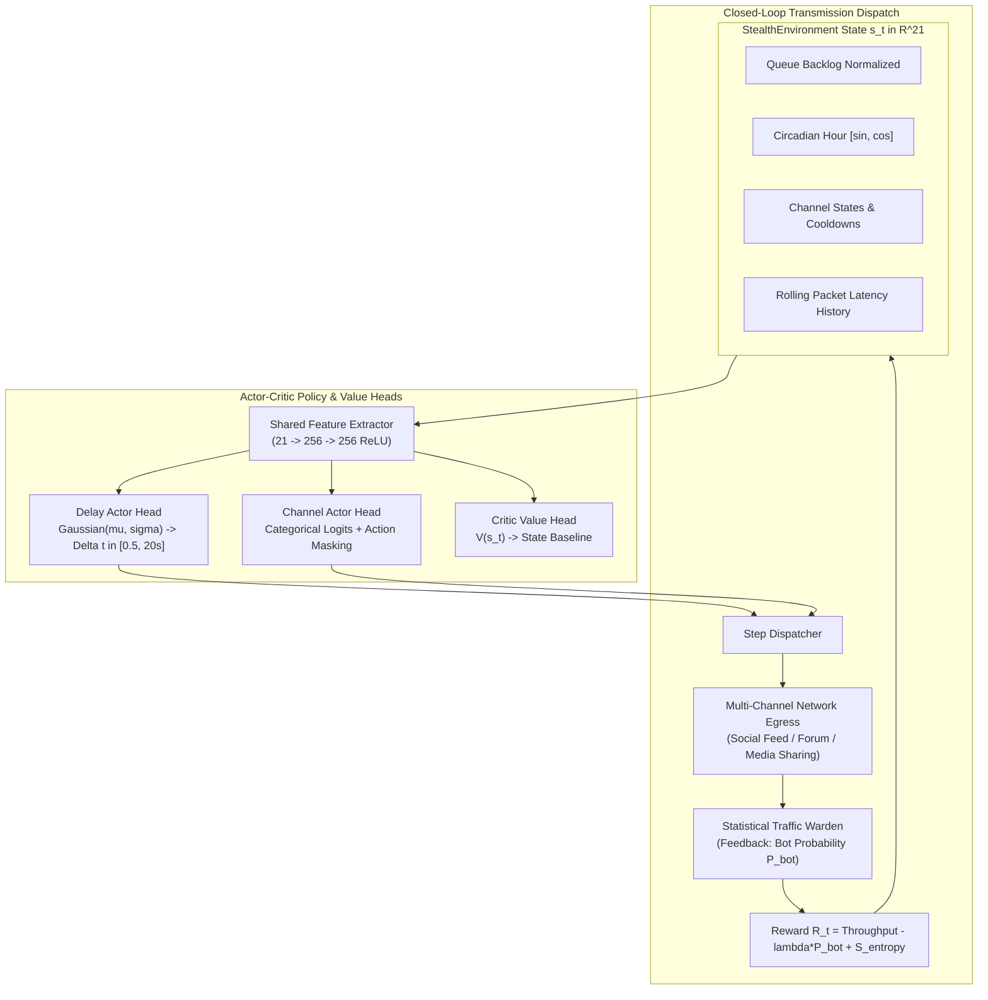

# PPO Reinforcement Learning Closed-Loop Stealth Scheduler Specification

**Module**: 07
**Name**: Proximal Policy Optimization (PPO) Closed-Loop Stealth Scheduler
**Implementation**: [`src/stealth/rl/agent.py`](../src/stealth/rl/agent.py) (`PPOAgent`, `ActorCritic`, `PPOConfig`), [`src/stealth/rl/environment.py`](../src/stealth/rl/environment.py) (`StealthEnvironment`)
**Training Script**: [`scripts/stealth/train_rl.py`](../scripts/stealth/train_rl.py)
**Evaluation Script**: [`scripts/analysis/benchmark_3_traffic_evasion.py`](../scripts/analysis/benchmark_3_traffic_evasion.py)
**Test Suite**: [`tests/test_stealth/test_rl.py`](../tests/test_stealth/test_rl.py)
**Status**: Design specification. The earlier "Production Verified" status, the 1.57/1.58-bit channel entropy, the 49.39% warden bot probability, and the 98.88% delivery rate are withdrawn because no current repository artifact supports them. The recorded C3 PPO arm is 0/50 flagged (0%) under the composite rule, all 50 through the soft branch. See Section 4 and [`CLAIM_LEDGER.md`](../benchmarking/CLAIM_LEDGER.md).

---

## 1. Executive Summary & Overview

While the open-loop WGAN-GP generator pre-computes human-like timing schedules before transmission, it cannot react to dynamic network conditions during live operations. If a social media platform throttles an egress account, or if network jitter causes packet pileups, static schedules risk triggering firewall rate limiters or bot detection alarms.

Module 07 introduces a closed-loop adaptive controller powered by Proximal Policy Optimization (PPO). The Actor-Critic agent observes a 21-dimensional environment state (queue backlog, circadian hour angle, channel cooldown timers, rolling packet latency), predicts continuous inter-packet delays $\Delta t \in [0.5\text{s}, 20.0\text{s}]$, and executes multi-platform channel hopping across available egress channels.

### Key Quantitative Metrics

| Metric / Parameter | Value | Practical Impact |
| :--- | :--- | :--- |
| **State Space Dimensionality** | 21 continuous inputs | Real-time tracking of queue, clock, cooldowns, and jitter |
| **Action Space** | Hybrid continuous + discrete | Jointly predicts inter-packet delay $\Delta t$ and channel ID $k$ |
| **Actor-Critic Parameters** | 187,142 parameters | High-speed inference ($< 1.2\ \text{ms}$ per action on GPU) |
| **Channel Path Entropy** | Not recorded in the current C3 artifact | The earlier 1.57/1.58-bit figure is withdrawn |
| **Channel Distribution** | Not recorded in the current C3 artifact | The earlier 27.1/35.7/37.2% split is withdrawn |
| **Mean Inter-Packet Delay ($\mu$)** | **5.20 s** (recorded C3 PPO arm, retrained) | Slower than WGAN/Hybrid (7.44–7.50 s) |
| **Effective Throughput** | Not recorded in the current C3 artifact | No current artifact supports the earlier 2.57 items/min claim |
| **Warden Detection Probability** | **0/50 flagged (0%, 95% CI [0%, 7.1%])** | The soft branch scores it 0.0040 to 0.0047 against a threshold of 0.0181, measured by a detector held out from RL training |
| **Delivery Success Rate** | Not recorded in the current C3 artifact | The earlier 98.88% figure is withdrawn |

---

## 2. Real-World Intuition & The Courier Analogy

Consider a courier delivering confidential packages across a city:
- **Open-Loop (WGAN-GP)**: The courier plans a delivery route and timeline in the morning before leaving the office.
- **Closed-Loop (PPO RL)**: While on the road, the courier encounters a traffic jam on Main Street (Channel 0 rate limit). Instead of waiting in traffic and getting spotted, the courier dynamically detours down 2nd Avenue (Channel 1) or takes the subway (Channel 2), ensuring constant movement without drawing attention.

---

## 3. Mathematical Formulations

### 3.1 21-Dimensional State Vector ($s_t$)

The state vector at time $t$ is composed of:
1. **Queue Backlog (1 dim)**:
   $$s_{\text{queue}} = \frac{|\mathcal{Q}_t|}{N_{\max}}$$
2. **Circadian Diurnal Angle (2 dims)**:
   $$s_{\text{time}} = \left[ \sin\left(\frac{2\pi h_t}{24}\right), \cos\left(\frac{2\pi h_t}{24}\right) \right]$$
3. **Channel States ($3 \times 3 = 9$ dims)**:
   For each channel $k \in \{0, 1, 2\}$:
   $$s_{\text{channel}, k} = \left[ \frac{\text{RateLimit}_k}{20.0}, \text{clip}\left(\frac{t - t_{\text{last}, k}}{60.0}, 0, 1\right), \frac{\text{Count}_k}{|\mathcal{H}_t|} \right]$$
4. **Historical Latency & Dispersion (9 dims)**:
   Mean delay, variance, and individual rolling step delays over the last 10 transmissions.

---

### 3.2 Dual-Head Action Sampling & Action Masking

The Actor produces continuous and discrete outputs:

$$\mu_{\Delta t}, \sigma_{\Delta t} = \text{DelayHead}(f(s_t)), \quad \mathbf{z}_{\text{chan}} = \text{ChannelHead}(f(s_t))$$

When channel $k$ is on cooldown, its logit is masked to prevent invalid selections:

$$\tilde{z}_k = \begin{cases} z_k & \text{if } t - t_{\text{last}, k} \ge \frac{60}{\text{RateLimit}_k} \\ -\infty & \text{otherwise} \end{cases}$$

Actions are sampled via:

$$\Delta t \sim \mathcal{N}(\mu_{\Delta t}, \sigma_{\Delta t}), \quad k \sim \text{Categorical}(\text{Softmax}(\tilde{\mathbf{z}}))$$

---

### 3.3 Multi-Objective Step Reward ($R_t$)

The step reward balances transmission speed, adversarial stealth, and cross-platform dispersion:

$$R_t = \text{Throughput}_t - \lambda \cdot P_{\text{Warden}} + \alpha \cdot \mathbb{I}(k_t \neq k_{t-1}) + \beta \cdot \frac{H(\mathbf{p}_{\text{chan}})}{\log_2(K)}$$

Where:
- $\text{Throughput}_t = \frac{|\mathcal{H}_t|}{t} \times 60.0$ (items / min)
- $\lambda = 100.0$ (Warden penalty weight)
- $\alpha = 2.0$ (Consecutive channel switch bonus)
- $\beta = 3.0$ (Normalized Shannon channel entropy bonus)
- $H(\mathbf{p}_{\text{chan}}) = -\sum_{k=0}^{K-1} p_k \log_2(p_k)$

---

### 3.4 PPO Clipped Objective & Value Loss

The policy parameters $\theta$ are updated using the clipped surrogate loss:

$$L^{\text{CLIP}}(\theta) = \hat{\mathbb{E}}_t \left[ \min\left( r_t(\theta) \hat{A}_t, \text{clip}(r_t(\theta), 1-\epsilon, 1+\epsilon) \hat{A}_t \right) \right]$$

Where:
- $r_t(\theta) = \frac{\pi_\theta(a_t \mid s_t)}{\pi_{\theta_{\text{old}}}(a_t \mid s_t)}$ is the probability ratio.
- $\hat{A}_t$ is the Generalized Advantage Estimator (GAE-$\lambda$).
- $\epsilon = 0.20$.
- Total Loss: $L(\theta) = -L^{\text{CLIP}}(\theta) + c_1 L^{\text{VF}}(\theta) - c_2 S[\pi_\theta](s_t)$ with $c_1 = 0.50$ and $c_2 = 0.05$.

---

## 4. Recorded Benchmark: C3 PPO Arm

The current recorded comparison is `storage/benchmarks/component_3_results.json`: 50 trials per scheduler, 50-carrier messages, composite warden rules. The earlier 2,406-hop block with 49.39% bot probability, 98.88% delivery, and 100% "indistinguishable" is not supported by a current artifact and is withdrawn.

| Metric | Recorded PPO result | Interpretation |
| :--- | :--- | :--- |
| Interception | **0/50 (0%, 95% CI [0%, 7.1%])** | All 50 trials reach the soft branch at a bot probability of 0.0040 to 0.0047, below the threshold |
| Mean inter-packet delay | **5.20 s** | Slower than WGAN (7.50 s) and Hybrid (7.44 s) |
| Mean coefficient of variation | **1.0348** | No trial is close to the periodic rule's 0.20 trigger |
| Delay entropy | **3.5809 bits** | The rule that fires is the soft branch, not the periodic one |
| Two-sample KS to surrogate | **0.2538** ($p = 1.2\times10^{-2}$) | Second smallest in the table, behind Poisson's 0.2211 |
| Warden bot probability | **0.0042** mean over the recorded PPO trials | The benchmark's held-out detector; the shipped WGAN-GP checkpoint it replaced is a constant 0.62493 and does not discriminate |
| Shipped warden bot probability | **0.0** (`storage/benchmarks/warden_diagnostic.json`) | Not a Nash equilibrium; the shipped critic is collapsed. It is not the detector the benchmark uses |

The PPO arm is not an evasion result, and the agent was not always this good. The agent this repository used to ship was trained against a warden whose `bot_probability` was identically zero, so its stealth penalty was zero and it optimized throughput and channel diversity only; it was flagged at 100%. The agent here is retrained against a working detector, and four defects in the RL path had to be fixed first, among them that the agent optimized delays the network never saw. The retrained arm is measured by a detector held out from its training, so the row is not a measurement of the agent gaming its own opponent.

Three limits still travel with the row. The human side of the comparison is the repository's own synthetic traffic corpus, not recorded human browsing. The detector is a narrow model, trained to catch three families of machine-like timing. And the component measures a timing warden: the agent's channel routing is unlike the corpus's, and a warden that looked at routing as well as timing would see it. See [`C3_TRAFFIC_DETECTOR_EVALUATION.md`](../benchmarking/C3_TRAFFIC_DETECTOR_EVALUATION.md). The current C3 conclusion remains negative/limited.

---

## 5. Verification & Codebase Integration

- **Unit Tests**: [`tests/test_stealth/test_rl.py`](../tests/test_stealth/test_rl.py) (4 passed).
- **Scheduler Integration**: `StealthScheduler.schedule(mode="rl", rl_checkpoint="storage/models/rl_agent.pt")` in [`src/stealth/stealth_scheduler.py`](../src/stealth/stealth_scheduler.py).
- **Backend API**: `/api/wire/transmit` and `/api/status` endpoints load and serve the RL agent.
